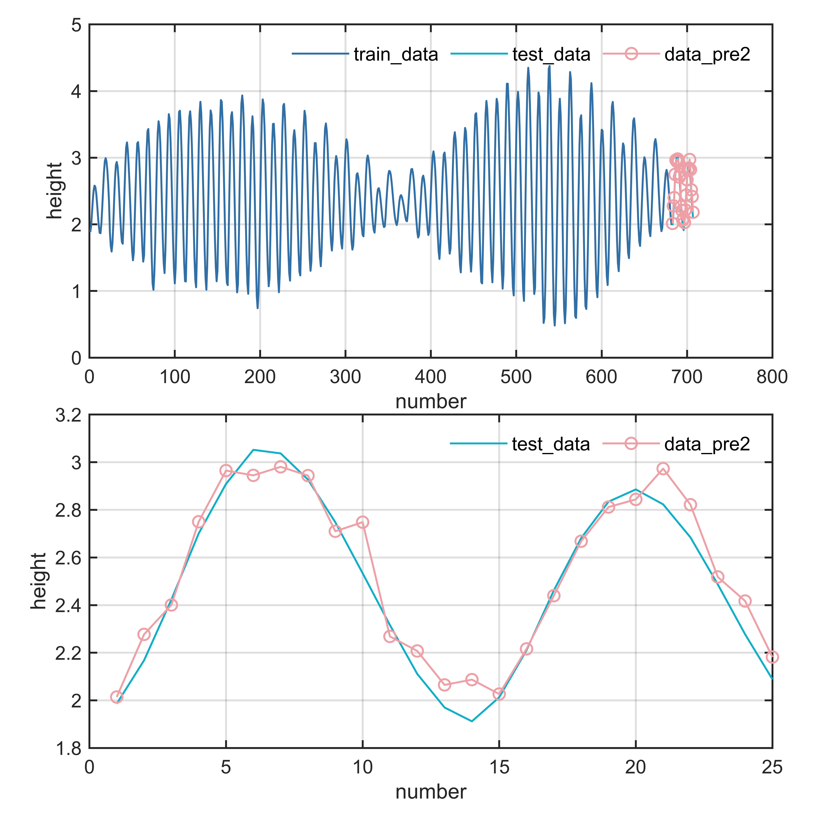

# MATLAB | Time Series Forecasting | BP Neural Network | Includes Data and Plotting Code | Direct Starter

BP neural networks are a common type of artificial neural network, also known as supervised learning neural networks. Their full name is "Back Propagation," which refers to the backpropagation algorithm. A BP neural network consists mainly of three layers: the input layer, the hidden layer, and the output layer, each consisting of multiple neurons. The learning process of a BP neural network involves continuously adjusting weights and biases to progressively improve the network's accuracy. The training process of a BP neural network can be divided into two stages: forward propagation and backpropagation. In forward propagation, the input signals pass through the neurons of each layer, ultimately producing an output result. In backpropagation, the error between the output result and the expected result is fed back into the network, and based on the magnitude of the error, the weights and biases of the neurons in each layer are adjusted to reduce the error gradually, thereby improving the network's accuracy. The advantage of BP neural networks is that they can handle nonlinear problems, perform parallel computations, and adaptively learn and adjust the weights and biases.
The attached images show the following effects:
\n        \n      The video tutorial operation is as follows:
\n        \n          \n          \n          \n          \n            To view this video please enable JavaScript, and consider upgrading to a\n            web browser that\n            supports HTML5 video\n  

## Images

<!-- PAYMENT_BLOCK -->

## Get this dataset

- Payment link (Stripe): [Buy now](https://buy.stripe.com/3cs8yP7sY87d0vu9AB)
- Payment QR code: 

<!-- /PAYMENT_BLOCK -->
